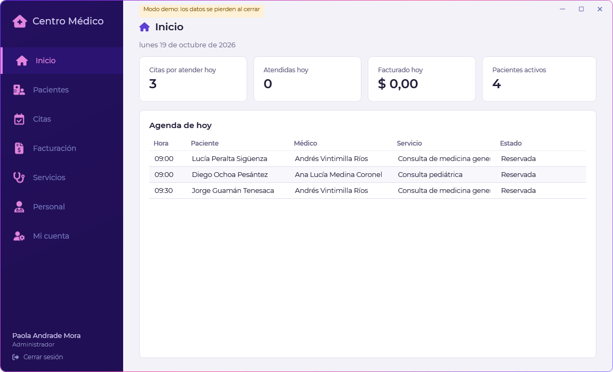
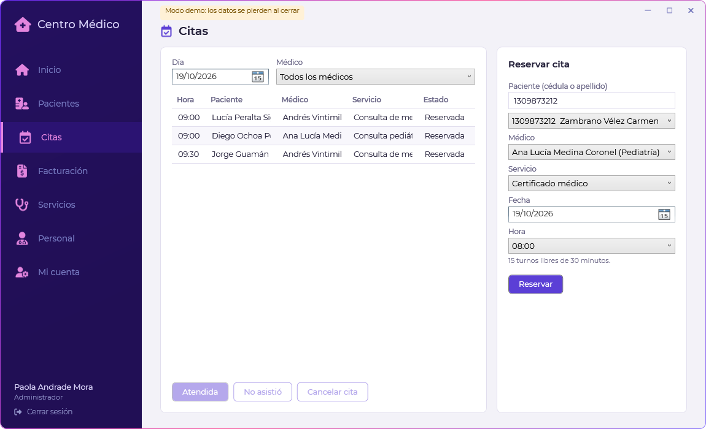
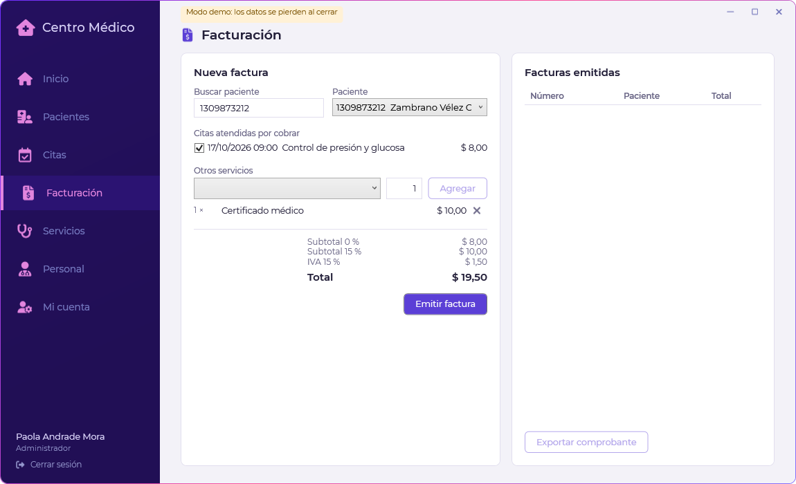
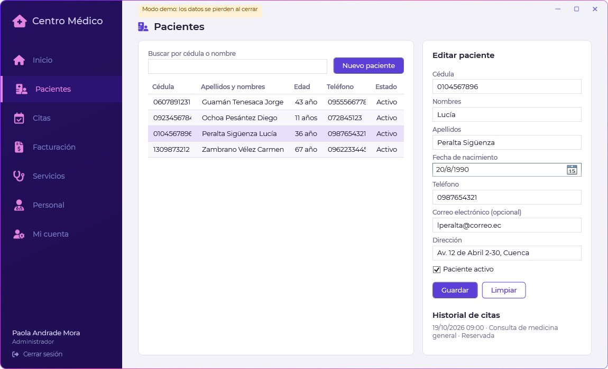
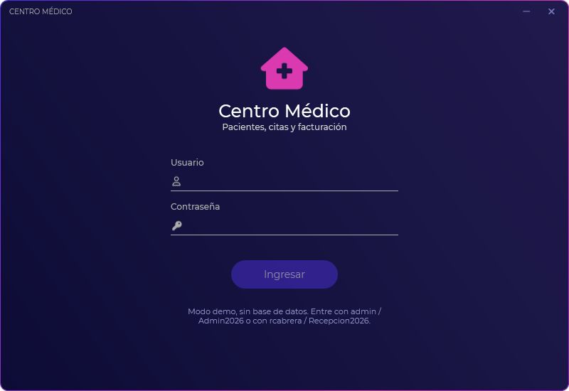

# csharp-centro-medico

[](https://github.com/Whiteherobot/csharp-centro-medico/actions/workflows/ci.yml)

Aplicación de escritorio para la recepción de un centro médico, en C# con WPF
y Oracle. Proyecto de la UPS de junio y julio de 2024, terminado en 2026.



- **Pacientes**: búsqueda por cédula o nombre, alta y edición con validación
  de la cédula ecuatoriana (módulo 10), activar o desactivar e historial de
  citas.
- **Citas**: agenda por día y médico. Al reservar solo se ofrecen los turnos
  libres de 30 minutos (lunes a viernes de 8:00 a 17:00 con almuerzo, sábados
  hasta el mediodía). La cita se marca como atendida, no asistió o cancelada.
- **Facturación**: cobra las citas atendidas y los servicios sueltos. Las
  consultas van con tarifa 0 % de IVA y lo que grava (certificados, insumos)
  con el 15 %. Numeración 001-001-000000001 y comprobante en texto.
- **Servicios y personal** (solo administradores): catálogo con precios,
  médicos con especialidad y cuentas de acceso con permiso de recepción o de
  administrador.

| Citas | Facturación |
|---|---|
|  |  |
| **Pacientes** | **Inicio de sesión** |
|  |  |

Las capturas las genera el CI en Windows con los datos del modo demo.

## Cómo correrlo

Necesitas Windows y el SDK de .NET 10.

```bash
dotnet run --project src/CentroMedico.App
```

Sin configurar nada abre en **modo demo**, con datos en memoria: entra con
`admin` / `Admin2026` (administrador) o `rcabrera` / `Recepcion2026`
(recepción).

Para trabajar con Oracle, levanta la base con Docker (Oracle Database Free
23ai, con el esquema y los mismos datos de ejemplo) y define la cadena de
conexión:

```bash
docker compose up -d
set CENTROMEDICO_ORACLE=User Id=centromedico;Password=CentroMedico2026;Data Source=localhost:1521/FREEPDB1
dotnet run --project src/CentroMedico.App
```

También se puede escribir en `appsettings.json`, junto al ejecutable. Si Oracle
no responde, la app ofrece abrir en modo demo. Los scripts están en `db/` por
si prefieres cargarlos en un Oracle XE propio.

## Estructura

```
src/
├── CentroMedico.Core        modelos, validaciones y reglas (agenda, facturación,
│                            inicio de sesión); no conoce la base ni la interfaz
├── CentroMedico.Datos       repositorios de Oracle (ODP.NET) y en memoria
├── CentroMedico.ViewModels  un ViewModel por pantalla, sin dependencias de WPF
└── CentroMedico.App         vistas WPF, estilos y arranque
db/                          esquema y datos de ejemplo
tests/
├── CentroMedico.Tests       reglas, ViewModels y repositorios contra Oracle
└── CentroMedico.App.Tests   dibuja cada vista y falla si el XAML tiene errores
```

Los ViewModels están en una librería aparte para poder probarlos sin Windows.
Las pruebas cubren las reglas de la agenda y la factura, el hash de las
contraseñas y cada pantalla. Las de repositorios corren contra un Oracle real
si se define `CENTROMEDICO_ORACLE_PRUEBAS` y vacían las tablas, así que
necesitan un esquema propio. En GitHub Actions corren contra Oracle en Linux,
y la app se compila en Windows, donde se guardan las capturas de cada vista.

## Base de datos

Se conservan las tablas `idm_*` del proyecto original. Una persona puede ser
paciente y empleado a la vez: sus datos están una sola vez en `idm_personas` y
cada rol guarda su propio estado. Un índice único basado en función impide dos
citas vigentes del mismo médico en el mismo turno, aunque dos equipos reserven
al mismo tiempo, y una factura se guarda junto con la marca de sus citas o no
se guarda nada.

## De dónde sale

La versión de 2024 tenía el login con Oracle, el registro de empleados y el
diseño de las pantallas: la ventana sin bordes, el menú lateral morado y los
formularios. Las pantallas de pacientes, citas, facturas y servicios tenían los
botones sin código. Las contraseñas se guardaban y comparaban en texto plano, la
clave de la base estaba escrita en el código y desde el login cualquiera podía
crearse una cuenta de administrador. El esquema de la base no estaba en el repo.

En 2026 se migró de .NET Framework 4.8 a .NET 10, se reconstruyó el esquema, se
separó la lógica en capas con pruebas y se completaron los módulos, conservando
el diseño original. Las contraseñas ahora se guardan con PBKDF2 y las cuentas
las crea un administrador.

## Autor

Michael Lata ([@Whiteherobot](https://github.com/Whiteherobot))

Créditos de la fuente y los iconos en [docs/CREDITOS.md](docs/CREDITOS.md).

Licencia MIT.
